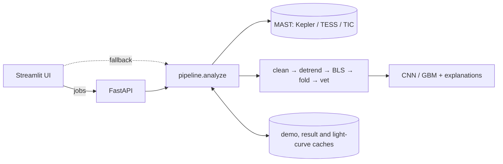

# 🪐 Exoplanet Transit Hunter

**Type a star. Get its NASA light curve, the periodic dips hiding in it, and an explained verdict:
Planet Candidate, Eclipsing Binary, or Other False Positive.**

<!-- Replace with a GIF of the demo flow (record with the UI at 1440 px wide). -->


## The problem

NASA's TESS mission has produced more than 8,000 TESS Objects of Interest, and thousands of them
still haven't been confirmed or ruled out. Machine-learning searches of TESS full-frame images
add thousands more each year. Most of these dips are not planets: they're pairs of stars
eclipsing each other, or instrument glitches. An astronomer still checks each one by hand.

## What it does

1. **Fetches** the light curve from NASA's MAST archive (Kepler or TESS) for any name or ID:
   `Kepler-10`, `KIC 11904151`, `TIC 261136679`.
2. **Cleans and detrends** it (flare clipping, wotan biweight).
3. **Searches** for periodic transits with a fast parallel Box Least Squares, iteratively, so
   multi-planet systems show up.
4. **Vets** each signal the way a human would: odd/even depths, secondary eclipse, transit shape,
   duration vs. period, and implied radius.
5. **Classifies** it with a dual-branch 1D CNN (AstroNet-style global and local views plus scalar
   features), with a LightGBM baseline alongside.
6. **Explains** the decision: Integrated Gradients over the exact views the model saw, plus a
   plain-language "Explain like I'm 12" mode.

## Quickstart

```bash
make setup      # Python 3.11 env + all dependencies (needs uv: https://docs.astral.sh/uv/)
make demo       # API on :8000, UI on http://localhost:8501
```

After the team runs `make export-model` and `make warm-cache` and commits `models/final/` and
`data/demo_cache/` (both a few MB), these two commands give a working demo from a fresh clone,
even offline. To build everything from scratch:

```bash
make data-download LIMIT=800 TESS_LIMIT=400 WORKERS=8 PURGE=1   # Kepler + TESS (resumable, ~hours)
make data-process && make train && make export-model
make warm-cache                                  # re-compute the demo stars with the new model
```

## Results

Trained on **Kepler and TESS** together (TESS eclipsing-binary labels from the Prša et al. 2022
catalog). Test split: real signals from **stars never seen in training** (splits are by star;
synthetic examples are excluded). Generated by `make train`; full numbers are in
`models/results.md`.

| Model | Macro PR-AUC | Macro F1 | PC recall @ 95% precision | ECE (PC) |
|---|---|---|---|---|
| Dual-branch CNN | _fill after training_ | | | |
| LightGBM baseline | _fill after training_ | | | |

CPU inference: < 1 ms per candidate (≈ 15 ms with explanations). A TESS sector searches in
≈ 0.1 s; 4 years of Kepler takes a few seconds per core.

## Architecture



The same `build_example` function turns a signal into model inputs for both training and
inference, so the two can't drift apart. Details: [docs/ARCHITECTURE.md](docs/ARCHITECTURE.md).

## Documentation

| Doc | Contents |
|---|---|
| [SCIENCE.md](docs/SCIENCE.md) | The transit method, BLS and false positives, explained simply |
| [ARCHITECTURE.md](docs/ARCHITECTURE.md) | System, data-flow and request diagrams; module map; design decisions |
| [DATA_CARD.md](docs/DATA_CARD.md) | Sources, label mapping, splits, biases, licenses |
| [MODEL_CARD.md](docs/MODEL_CARD.md) | Models, training, metrics, limitations, intended use |
| [API.md](docs/API.md) | Endpoints, request/response examples, error codes |
| [DEMO_SCRIPT.md](docs/DEMO_SCRIPT.md) | 3-minute pitch, click-by-click demo, judge Q&A, stage fallbacks |
| [HACKATHON_PLAN.md](docs/HACKATHON_PLAN.md) | 18-hour, 4-person plan with checkpoints |
| `notebooks/` | 01 light curves and the dataset · 02 BLS step by step · 03 model evaluation |

## The app

`make demo` walks through six panels: raw light curve → detrended → BLS periodogram → folded
transit with model fit → verdict (class, confidence, vetting badges, planet size) → why the model
decided. Toggle **Explain like I'm 12** in the sidebar for plain-language captions.

If the API is down, the UI runs the pipeline in-process instead, and demo stars load from
`data/demo_cache/`. For bad venue Wi-Fi, set `TH_OFFLINE=true` in `.env`.

## Development

```bash
make check          # ruff + mypy + pytest (same as CI); offline, ~1 min
make test-network   # live MAST / Exoplanet Archive tests
make help           # every target
```

| Path | What lives there |
|---|---|
| `configs/` | `data.yaml`, `model_cnn.yaml`, `model_gbm.yaml`, `demo_targets.yaml` |
| `src/transit_hunter/` | Library: data, processing, vetting, models, pipeline, API |
| `scripts/` | Dataset build, training, demo cache, hunt mode |
| `frontend/` | Streamlit app, Plotly figures, backend client |
| `tests/` | 80+ tests on synthetic data; `-m network` for live tests |

Docker: `make docker-build && make docker-up` (API on 8000, UI on 8501; `data/` and `models/`
are mounted).

## Limitations

This tool flags **candidates for follow-up**; it does not confirm planets. Training labels are
noisy (TESS more than Kepler), and the probabilities are calibrated to a class-balanced sample.
See the [model card](docs/MODEL_CARD.md) and [data card](docs/DATA_CARD.md).

## Team

| Name | Role |
|---|---|
| Atharv Das| ML: models, training, evaluation |
| Anshumant| Data: labels, dataset, demo stars |
| Shubh Agarwal| Backend: pipeline, API, integration |
| Jigar Singh Chandel| Frontend, docs, pitch |

## Acknowledgements

This research has made use of the **NASA Exoplanet Archive**, which is operated by the California
Institute of Technology, under contract with NASA under the Exoplanet Exploration Program. It
includes data collected by the **Kepler** and **TESS** missions, obtained from the **MAST** data
archive at the Space Telescope Science Institute (STScI). Funding for the Kepler and TESS missions
is provided by the NASA Science Mission Directorate. STScI is operated by the Association of
Universities for Research in Astronomy, Inc., under NASA contract NAS 5-26555.

Built on [lightkurve](https://github.com/lightkurve/lightkurve),
[wotan](https://github.com/hippke/wotan), [astropy](https://www.astropy.org/),
[astroquery](https://astroquery.readthedocs.io/), PyTorch, LightGBM, Captum, FastAPI, Streamlit
and Plotly. The model design follows Shallue & Vanderburg (2018), *Identifying Exoplanets with
Deep Learning*, AJ 155, 94. TESS eclipsing-binary labels come from Prša et al. (2022), ApJS 258, 16.

## How to cite

See [`CITATION.cff`](CITATION.cff) (GitHub shows a "Cite this repository" button). Please also
cite lightkurve, wotan, and Shallue & Vanderburg (2018) if you use the model design.

## License

MIT for the code. Kepler and TESS data are public NASA mission data.
