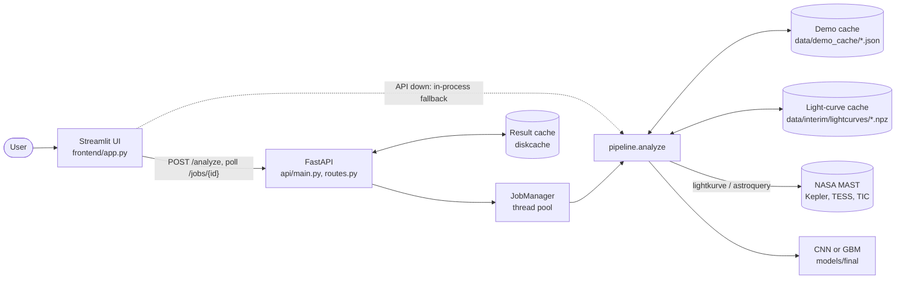
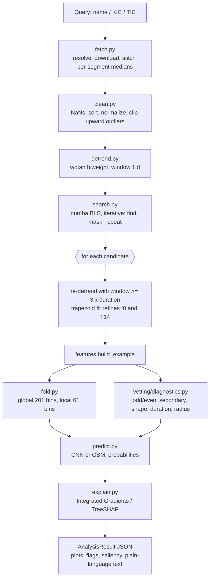
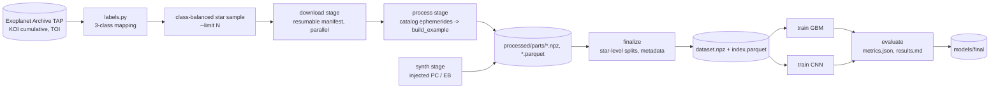
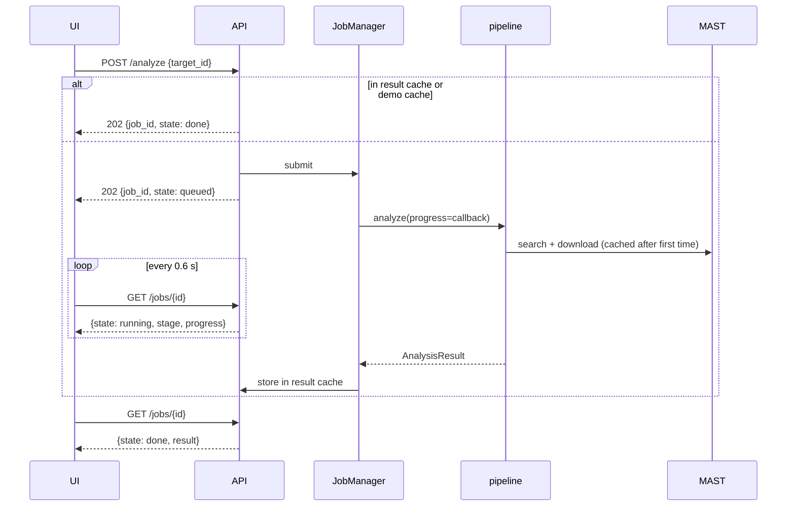

# Architecture

## System overview

* **One code path for analysis.** The API, the UI's fallback, `scripts/hunt.py` and
  `scripts/warm_demo_cache.py` all call `transit_hunter.pipeline.analyze`.
* **One code path from signal to model input.** Training (`data/build.py`) and inference
  (`pipeline.py`) both call `processing.features.build_example`, so the views and features can't
  drift apart.
* **Three caches, cheapest first.**
  1. The demo cache holds full results, so demos work offline.
  2. The result cache is keyed by request, model checkpoint and pipeline version.
  3. The light-curve cache holds arrays, so a target is never downloaded twice.

## Inference data flow

## Training data flow

## Request lifecycle

## Module map

| Module | Responsibility |
|---|---|
| `config.py` | Typed settings (`TH_*` env vars) and validated YAML configs |
| `data/fetch.py` | Target parsing, MAST search/download, retries, light-curve cache, TIC lookup |
| `data/labels.py` | TAP queries, KOI/TOI → PC/EB/FP mapping, balanced star sampling |
| `data/build.py` | Dataset stages: labels, download, process, synth, finalize |
| `data/dataset.py` | Processed-dataset storage, star-level splits, PyTorch `Dataset` + augmentation |
| `data/synthetic.py` | Synthetic light curves and transit/EB injection (tests, fallback data) |
| `processing/clean.py` | Cleaning and normalization |
| `processing/detrend.py` | wotan biweight / Savitzky–Golay detrending |
| `processing/search.py` | Period grid, numba + astropy BLS engines, iterative search |
| `processing/fold.py` | Phase folding, global/local views |
| `processing/features.py` | Scalar features and `build_example` (the single signal → model-input function) |
| `vetting/diagnostics.py` | Odd/even, secondary eclipse, off-phase dip, shape, duration, radius |
| `models/cnn.py` | Dual-branch CNN, feature scaler |
| `models/gbm.py` | LightGBM baseline, view summaries, TreeSHAP |
| `models/train.py` | Training loops, focal loss, class weights, checkpoints |
| `models/evaluate.py` | Metrics, comparison table |
| `models/predict.py` | Common predictor interface, model selection (`auto`) |
| `models/explain.py` | Integrated Gradients (CNN), TreeSHAP (GBM) |
| `pipeline.py` | `analyze()`, `hunt()`, demo cache, trapezoid fit, plain-language explanations |
| `api/` | FastAPI app, routes, job manager, result cache, schemas |
| `frontend/` | Streamlit app, Plotly figures, backend client with in-process fallback |

## Design decisions

| Decision | Why |
|---|---|
| Train on catalog ephemerides, infer on BLS ephemerides + trapezoid refinement | Keeps BLS errors out of the labels. Refining T14 at inference matches the catalog durations used in training. Without it, BLS boxes run ~25% short and V-shaped EBs look U-shaped. |
| Own numba BLS (astropy kept as reference) | 4 years of Kepler data needs ~250k trial periods. astropy takes ~0.7 ms per period; the numba version runs in parallel on every core. A test checks the two engines agree. |
| Splits by star, from real signals only | Multi-planet systems can't leak across splits, and adding synthetic data never reshuffles the real test set. |
| Views normalized to median 0, minimum −1 | AstroNet convention. Absolute depth goes in as a scalar feature, so the views carry only shape. |
| Thread-pool jobs, not Celery/Redis | One-process deployment for a hackathon. numba already parallelizes BLS across cores. |
| Streamlit + Plotly | Fastest path to an interactive, story-driven UI. The API is UI-agnostic, so a React front end can replace it later. |
